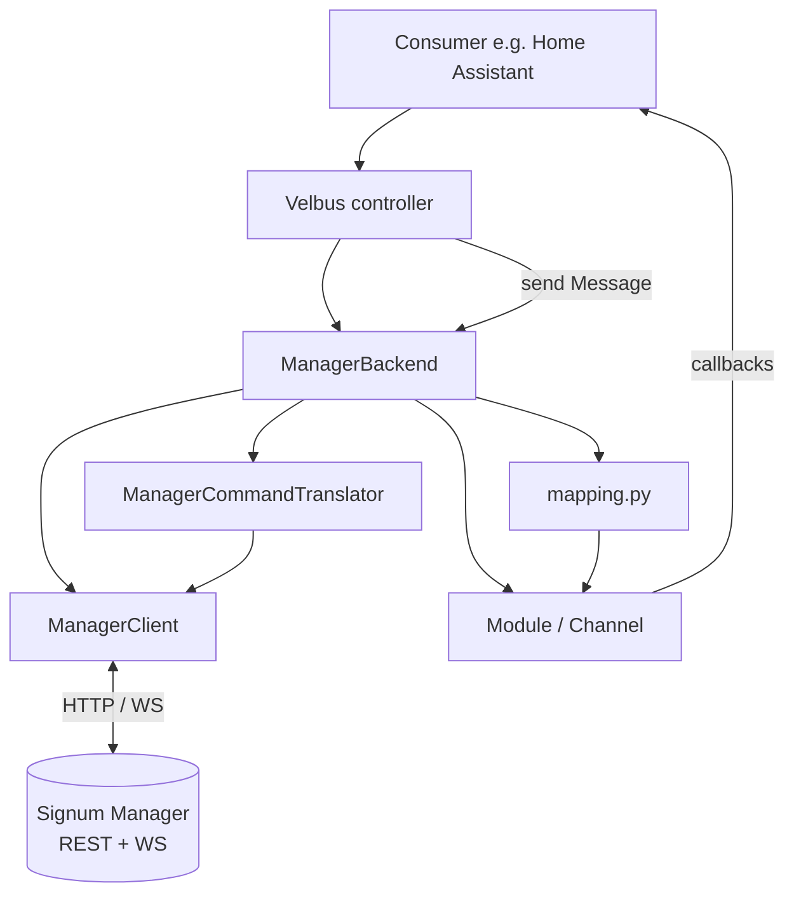
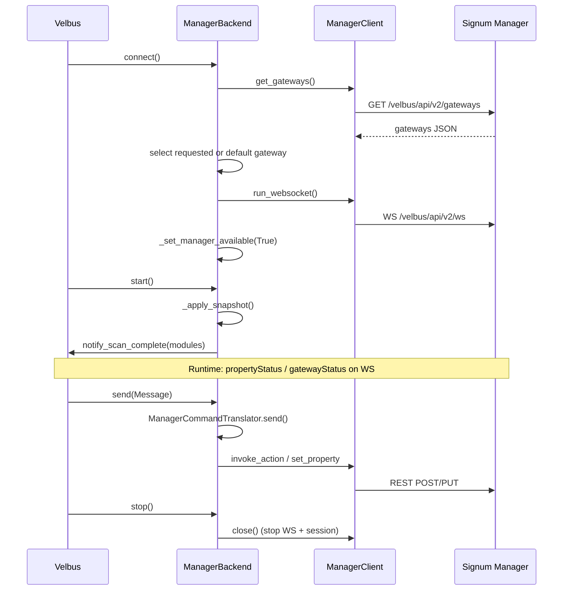

# Signum Manager backend

How `velbus-aio` drives a Velbus installation through **Signum Manager** (Velbus
Signum hardware or compatible) instead of a raw serial, TCP, or TLS bus link.

Signum exposes a **REST API v2** plus a **push WebSocket** on port **4201** (plain
HTTP in current integrations). The library mirrors the same `Velbus` controller
API that integrators already use for direct bus access; only the transport and
discovery path change.

## Connecting

| DSN                   | Example                      | Notes                                                  |
| --------------------- | ---------------------------- | ------------------------------------------------------ |
| `manager://host:port` | `manager://192.168.1.9:4201` | Manager REST + WebSocket                               |
| `gateway_id` kwarg    | Gateway ID from discovery    | Optional. Bind the controller to one bus              |
| `access_token` kwarg  | Bearer token                 | Optional; required when the manager enforces auth      |
| `session` kwarg       | `aiohttp.ClientSession`      | Optional; share a session with Home Assistant or tests |

When `Velbus` is constructed with a `manager://` DSN, `controller.py` sets
`_backend` to a `ManagerBackend` instead of `RawBusBackend` (direct bus):

```python
controller = Velbus(
    "manager://192.168.1.9:4201",
    session=my_session,
    access_token="…",
)
await controller.connect()
await controller.start()
```

Public exports live in `velbusaio.bus.manager`: `ManagerBackend`, `ManagerClient`,
`VelbusManagerError`.

### Choosing a bus

For a bus picker, call `ManagerClient.get_gateways()` before connecting a
controller. Display each gateway's `name` and store its `id` as the selection.
A gateway can be renamed.

```python
from velbusaio.bus.manager import ManagerClient
from velbusaio.controller import Velbus

client = ManagerClient(host, port, session=my_session, access_token=token)
try:
    gateways = await client.get_gateways()
finally:
    await client.close()

choices = {
    gateway["id"]: gateway.get("name") or gateway["id"]
    for gateway in gateways
    if gateway.get("type") == "velbusgateway" or gateway.get("isLocalGateway")
}
```

Create one controller per selected gateway, using the ID from the picker.
Each controller exposes its own modules, channels and connection state.

```python
controller = Velbus(
    manager_dsn,
    session=my_session,
    access_token=token,
    gateway_id=selected_id,
)
try:
    await controller.connect()
    await controller.start()
    # Use the controller for this bus.
finally:
    await controller.stop()
```

An explicit ID that is missing from discovery raises `VelbusConnectionFailed`
during `connect()`. Omitting `gateway_id` preserves automatic selection.
After connection, `controller.manager_backend.gateway_id` gives the selected ID.

## Architecture



| Module                     | File                                | Responsibility                                                        |
| -------------------------- | ----------------------------------- | --------------------------------------------------------------------- |
| `ManagerClient`            | `velbusaio/bus/manager/client.py`   | aiohttp REST calls and resilient WebSocket loop                       |
| `ManagerBackend`           | `velbusaio/bus/manager/backend.py`  | Gateway selection, installation snapshot, thing-id maps, live updates |
| `ManagerCommandTranslator` | `velbusaio/bus/manager/commands.py` | Outbound `Message` → Signum actions/properties                        |
| Mapping helpers            | `velbusaio/bus/manager/mapping.py`  | Signum property names ↔ velbusaio channel/property update dicts       |
| `VelbusManagerError`       | `velbusaio/bus/manager/errors.py`   | HTTP/transport failures (401 → `VelbusAuthenticationFailed`)          |

The controller delegates `connect`, `start`, `stop`, `scan`, `send`,
`is_connected`, and `sync_clock` to `ManagerBackend` when Signum mode is active.
`Module.set_memo_text` also routes through the backend when present.

## Lifecycle



### `connect()`

1. `GET /gateways` — failure becomes `VelbusConnectionFailed`; HTTP 401 fires
   auth-failed callbacks and raises `VelbusAuthenticationFailed`.
2. Select the requested ID when supplied. Automatic selection prefers the local
   gateway and falls back to the first Velbus gateway.
3. Record `gateway_id` and initial Velbus link state from gateway `state`
   (`Connected` → bus up).
4. Start the WebSocket task and wait up to 5s for the first successful connect.

### `start()`

Runs `_apply_snapshot()` once, then calls `Velbus.notify_scan_complete` with the
current module address set — the Signum equivalent of finishing a bus scan
without walking addresses 1–254.

### `scan()`

Invokes gateway action `Quickupdate` (bus scan plus memory-map read for names),
polls `GET /things/{gatewayId}/actions` until the manager’s action queue is idle
(or times out after ten minutes), refreshes the snapshot, and notifies scan-complete
again. Stale modules that disappear from the actor list are removed via
`Velbus.remove_stale_module`.

### Connection semantics

`ManagerBackend.is_connected` is **true** only when both:

- the manager is considered available (WebSocket up, or recovered after disconnect), and
- the gateway reports Velbus bus state `Connected` (`gatewayStatus` WebSocket messages).

Disconnecting the WebSocket marks the manager unavailable. A controller bound
to a specific gateway rechecks its ID on reconnect and refreshes the inventory
if discovery was started. If the ID is missing, the controller stays offline
and retries with the same ID.

## ManagerClient (REST and WebSocket)

Base URL pattern:

- REST: `http://{host}:{port}/velbus/api/v2{path}`
- WebSocket: `ws://{host}:{port}/velbus/api/v2/ws`

| Method                                      | Signum endpoint                                    | Use in velbus-aio                      |
| ------------------------------------------- | -------------------------------------------------- | -------------------------------------- |
| `get_gateways()`                            | `GET /gateways`                                    | Pick gateway at connect                |
| `get_actors(gateway_id)`                    | `GET /gateways/{id}/actors?includeProperties=true` | Installation snapshot                  |
| `invoke_action(thing_id, name, inputs)`     | `POST /things/{id}/actions/{name}`                 | Relays, dimmers, covers, thermostat, … |
| `set_property(thing_id, prop, value)`       | `PUT /things/{id}/properties/{prop}`               | LED state                              |
| `get_running_actions(thing_id)`             | `GET /things/{id}/actions`                         | Wait for Quickupdate to finish         |
| `wait_for_gateway_actions_idle(gateway_id)` | Polls `get_running_actions`                        | Used after `Quickupdate`               |
| `gateway_action(gateway_id, name)`          | Same as `invoke_action` on gateway id              | `Quickupdate` on `scan()`              |

The WebSocket loop reconnects with exponential backoff (1s → 30s cap), 30s
heartbeat, until `stop_websocket()` / `close()` sets the stop event. Each JSON
text frame is passed to the backend’s `on_message` callback.

With an explicit gateway, each WebSocket connection requests `?gatewayId=<id>`,
including on reconnect. The backend also checks the gateway or thing ID in
incoming messages so it can use an older Manager with an unfiltered feed.
When configured, the client sends the bearer token on REST requests and on
the WebSocket handshake.

## Installation snapshot (`_apply_snapshot`)

Protected by `_snapshot_lock` to avoid overlapping full reads.

For each actor with `type == "velbusmodule"`:

1. **Type** — `manager_module_type_to_code(moduleType)` maps Signum names to velbus
   type codes via `MODULE_DIRECTORY` (with `_` → `-` normalisation and overrides
   such as `VMBDMI_R` → `VMBDMI-R`). Unknown types are skipped with a warning.
2. **New module** — `Velbus.add_module` with serial and build year/week from
   `parse_build_number`. Sub-addresses from `subAddresses` feed
   `add_submodules` when not `0xFF`.
3. **Naming** — module display name from Signum `name`.
4. **Thing IDs** — `actor["id"]` → `_module_things[address]`; each channel’s
   `id` → `_channel_things[(address, channel_num)]` and reverse
   `_thing_channels[thing_id]`.
5. **Channel numbers** — `remap_channel_number(module_type, channelId)` (table
   `CHANNEL_REMAPS` is empty by default; extend per type when Signum IDs differ
   from the Velbus spec).
6. **Channel load** — `Module.load_from_manager(channels)` builds default channels,
   applies Signum channel names, marks channels loaded (no EEPROM walk).
7. **Initial state** — channel `properties` → `map_properties_to_update` →
   `module._update_channel`; module-level properties → `map_module_properties` →
   `_update_property`. Dimmer `Brightness` seeds
   `ManagerCommandTranslator._last_brightness` for `RestoreDimmerMessage`.

Addresses present locally but missing from the snapshot are pruned.

## Live updates (WebSocket)

| `messageType`    | Handler                   | Effect                                                                 |
| ---------------- | ------------------------- | ---------------------------------------------------------------------- |
| `propertyStatus` | `_handle_property_status` | Resolve `thingId` to channel or module; apply same mapping as snapshot |
| `gatewayStatus`  | `_handle_gateway_status`  | Update `_bus_connected` from nested `data.state`                       |
| `actorStatus`    | —                         | Logged at debug only                                                   |

`propertyStatus` drives the same channel/property update path as the snapshot,
so integrators keep using module/channel callbacks without parsing bus frames.

## Outbound commands (`command_effect` + `ManagerCommandTranslator`)

`Velbus.send(msg)` eventually calls `ManagerBackend.send` → `translator.send(msg)`.
Each supported command message implements `command_effect()` in its own module
(see `velbusaio/command_effects.py` for transport-neutral types). The translator
calls `apply_command_effect()` in `bus/manager/effects.py` to map those effects to
Signum REST actions and properties.

### Bus-only messages (silently ignored)

These have no Manager API equivalent; the translator returns without a REST call:

`ModuleStatusRequestMessage`, `ModuleTypeRequestMessage`, memory read messages,
`ChannelNameRequestMessage`, `CounterStatusRequestMessage`, clock/date/DST setters,
`MemoTextMessage` (memo text uses `ManagerBackend.set_memo_text` + `SetMemoText`
action instead).

### Supported translations (summary)

| Velbus message family                             | Signum action / property                                                  |
| ------------------------------------------------- | ------------------------------------------------------------------------- |
| `PushButtonStatusMessage`                         | `Press`                                                                   |
| Switch relay on/off                               | `On` / `Off`                                                              |
| `SetDimmerMessage` / `SetDimmerMessage2`          | `Brightness` (+ optional `DimmerSpeed`; scale via channel `slider_scale`) |
| `RestoreDimmerMessage`                            | `Brightness` at last non-zero level (default 100)                         |
| Cover up/down/off/position                        | `Open` / `Close` / `Stop` / `Position`                                    |
| LED messages                                      | `PUT` property `Led` (`On`, `Off`, `Slow`, `Fast`, `VeryFast`)            |
| `SetTemperatureMessage`                           | `CurrentTemperature`                                                      |
| Thermostat mode switches                          | `SwitchToComfortMode`, etc.                                               |
| `TempSetHeatingMessage` / `TempSetCoolingMessage` | `HeatingMode` / `CoolingMode`                                             |
| `SelectProgramMessage`                            | module action `SelectProgram`                                             |

Unknown message types are logged at debug and dropped.

Thing lookup uses `_channel_things[(address, channel)]` built during snapshot;
if no thing id exists, the send is skipped.

## Inbound property mapping (`mapping.py`)

`map_properties_to_update(channel, properties)` turns Signum JSON properties into
the internal keys `Module._update_channel` expects, for example:

| Signum property                                       | velbusaio update keys (examples)           |
| ----------------------------------------------------- | ------------------------------------------ |
| `On`                                                  | `on`                                       |
| `Brightness`                                          | `state` (dimmer: scaled by `slider_scale`) |
| `Position`                                            | `position`                                 |
| `Up` / `Down` / `Halt`                                | cover `state` codes                        |
| `Pressed` / `Released` / `LongPressed`                | button `closed`, `on`, `long`              |
| `Led`                                                 | `led_state`                                |
| `Temperature`, `TargetTemperature`, `TemperatureMode` | climate fields                             |
| Counters, sensor values                               | `counter`, `pulses`, `cur`, etc.           |

`map_module_properties` handles module-level keys such as `LightSensorValue` and
`Program`.

## Differences from serial / TCP / TLS bus mode

| Topic            | Direct bus                             | Signum Manager                                              |
| ---------------- | -------------------------------------- | ----------------------------------------------------------- |
| Discovery        | `PacketHandler.scan()` probes 1–254    | `get_actors` snapshot; `scan()` runs `Quickupdate`          |
| Inbound traffic  | Parsed Velbus frames → `PacketHandler` | WebSocket `propertyStatus`                                  |
| Outbound traffic | Raw frames on the wire                 | REST actions/properties                                     |
| Module load      | Cache, EEPROM, status requests         | `load_from_manager` — names + loaded flags, no memory panel |
| `sync_clock`     | Supported on bus                       | `VelbusNotSupported`                                        |
| `is_connected`   | Protocol connected                     | Manager WS **and** gateway bus `Connected`                  |
| Authentication   | TLS / Velbus auth on gateway port      | Optional Bearer token on Manager API                        |

See also the limitations called out in the root [README](../README.md#supported-connections):
no EEPROM configuration UI path, emulated dimmer restore level, plain HTTP on 4201.

## Testing and parity tooling

| Asset               | Location                            | Purpose                                                                          |
| ------------------- | ----------------------------------- | -------------------------------------------------------------------------------- |
| `FakeManager`       | `tests/bus/manager/fake_manager.py` | In-process aiohttp server mimicking v2 routes + WS broadcast                     |
| `installation.json` | `tests/bus/manager/`                | Static gateway/module/channel fixture                                            |
| Unit tests          | `tests/bus/manager/test_*.py`       | Client, backend, commands, mapping, parity                                       |
| `signum_parity.py`  | `scripts/manager_parity.py`         | Compare entity unique-id keys between `tls://` and `manager://` on live hardware |

Run Signum tests from the package root, for example:

```bash
pytest tests/bus/manager/
```

## Extending the integration

- **New module types** — ensure `moduleType` strings resolve in `manager_module_type_to_code`; add overrides in `mapping._TYPE_NAME_OVERRIDES` if Signum naming diverges.
- **Channel ID mismatches** — populate `CHANNEL_REMAPS[module_type_code][signum_id] = velbus_channel`.
- **New Signum properties** — extend `map_properties_to_update` or `map_module_properties`.
- **New outbound Velbus commands** — add a branch in `ManagerCommandTranslator.send` and cover it in `tests/bus/manager/test_commands.py`.
